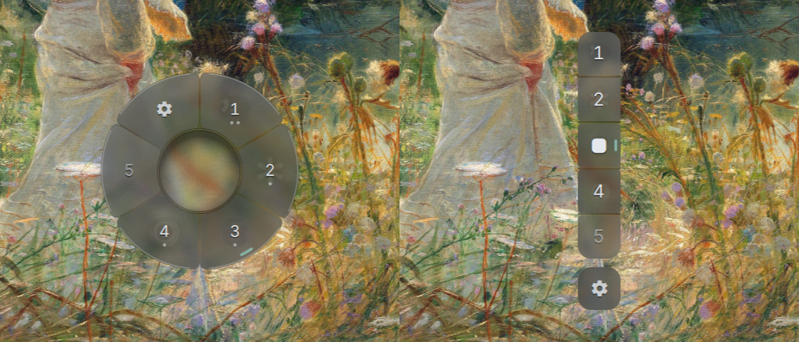

# Bloom

A mouse-first workspace switcher for the Omarchy shell. Open it at the cursor, hover a workspace to see its windows, click to switch, or drag a window onto another workspace to move it.



## Features

- Two layouts: **Bloom** (radial) and **Vertical** (column).
- Hover a workspace to reveal its windows.
- Click a workspace to switch to it.
- Drag a window icon onto another workspace to move it silently (focus stays where it is).
- Drop a window icon onto another window to place it side by side (dwindle workspaces; otherwise it is simply moved there).
- A Settings petal/slot (gear) with **Layout** (Bloom / Vertical) and **Theme** (Neutral / Omarchy).
- Never takes keyboard focus.

## Requirements

- Omarchy with its Quickshell shell.
- Hyprland 0.55 or newer with a **Lua** config (0.55 introduced the Lua config and every Lua dispatcher Bloom uses). Tested on 0.56. Bloom dispatches through Hyprland's Lua API, so it does not work with hyprlang configs.
- `python3`, only for side-by-side placement.
- A Nerd Font for the layout glyphs and the gear. Bloom asks fontconfig which installed family has them (Omarchy's own `monospace` family first, normally JetBrainsMono Nerd Font). Without one, the current vertical slot shows its number plus the accent tick and the gear a plain symbol.
- Omarchy's workspace layout files (`~/.local/state/omarchy/workspace-layouts/<n>.lua` and `default.lua`) are read for the layout glyphs and side-by-side placement. If they are missing, Bloom falls back to Hyprland's reported layout, then `dwindle`.
- Omarchy's `o.workspace_mode` Lua helper is called only during side-by-side placement (to briefly set a scratch workspace to dwindle). If that step fails, Bloom falls back to a plain move.

## Install

```sh
omarchy plugin add https://github.com/chrisdavila7/omarchy-bloom --enable
```

Bloom never edits your config. The steps below are optional and yours to add.

### Trigger (keybinding and/or gesture)

In `~/.config/hypr/bindings.lua`:

```lua
-- Keybinding (pick your own keys)
o.bind("SUPER + mouse:274", "Bloom", "omarchy-shell io.github.chrisdavila7.bloom toggle")

-- 3-finger swipe up
hl.gesture({
  fingers = 3,
  direction = "up",
  action = function() hl.exec_cmd("omarchy-shell io.github.chrisdavila7.bloom toggle") end,
})
```

`bin/bloom-toggle` runs the same command if you prefer a script path.

### Blur (optional)

In `~/.config/hypr/looknfeel.lua`:

```lua
hl.layer_rule({ match = { namespace = "^bloom$" }, blur = true, ignore_alpha = 0.2, no_anim = true, animation = "none" })
hl.layer_rule({ match = { namespace = "^bloom-veil$" }, no_anim = true, animation = "none" })
```

Bloom works without these but looks flatter. With blur on, the 2 px seams between petals/slots and the center well are drawn at an alpha above `ignore_alpha`, so they frost like the glass instead of showing the sharp wallpaper. Bloom keeps clear of bars that reserve screen space (Omarchy's bar on any side). Apply changes with `hyprctl reload`.

## Usage

Trigger Bloom with your binding or gesture (or `omarchy-shell io.github.chrisdavila7.bloom toggle`). It opens at the cursor. Hover, click, or drag as described above; toggle again to close.

### IPC

Run as `omarchy-shell io.github.chrisdavila7.bloom <function> [arg]`.

| Function | Argument | Result |
| --- | --- | --- |
| `toggle` | none | Open or close Bloom. |
| `layout` | `bloom` or `vertical` | Set the layout; returns the new value, or an error string. |
| `theme` | `neutral` or `omarchy` | Set the theme; returns the new value, or an error string. |
| `status` | none | JSON: `open`, `shown`, `pending`, `layout`, `theme`, `reducedMotion`. |

## Settings

Stored in `~/.local/state/bloom/settings.json`:

```json
{ "layout": "bloom", "theme": "omarchy" }
```

`layout` is `bloom` or `vertical`; `theme` is `neutral` or `omarchy`. Defaults are `bloom` and `omarchy`. Change them from the gear or over IPC.

## Reduced motion

Bloom follows Omarchy's own switch (`omarchy toggle animations off`, i.e. Hyprland animations disabled; the shell exposes it as `Style.reduceMotion`). When it is on, every animation duration is 0, there is no unfold stagger, overshoot, or pointer drift, and opening or closing is a single 80 ms fade. Chips, bands and the settings card fade for 90 ms instead of popping. `status` reports it as `reducedMotion`. There is no Bloom-specific setting.

## Removal

```sh
omarchy plugin remove io.github.chrisdavila7.bloom
```

Then delete the bind, gesture and layer rules you added, run `hyprctl reload`, and remove saved settings:

```sh
rm -rf ~/.local/state/bloom
```

## Dependencies and licenses

- Bloom's code: MIT (see `LICENSE`).
- Bundles the Inter font under the SIL Open Font License 1.1 (`assets/fonts/INTER-OFL.txt`).
- Runtime: Quickshell (via Omarchy), Hyprland, `hyprctl`, `python3`.

## Known limitations

- No keyboard navigation.
- Workspaces 1–5 are always shown.
- Multi-monitor setups and display scales other than 1.5 are untested.

## Development

```sh
node tests/test_geometry.js
node tests/test_column_geometry.js
python3 -m unittest discover tests
/usr/share/omarchy/bin/omarchy-plugin-validate .
```
